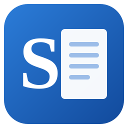

# Schreibwerk

Offline-Textverarbeitung im Stil von Microsoft Word – läuft komplett im Browser, ohne Installation und ohne Internet. Dokumente werden als **Word-Datei (.docx)** gespeichert und lassen sich in Word, LibreOffice und Google Docs weiterbearbeiten.



## Herunterladen und starten

1. Oben rechts auf **Code → Download ZIP** klicken (oder unter *Releases* die ZIP-Datei laden).
2. ZIP entpacken, z. B. nach `Dokumente\Eigene Apps\Schreibwerk`.
3. `index.html` doppelklicken – fertig.

**Als eigenes App-Fenster (empfohlen):** Verknüpfung mit folgendem Ziel anlegen (Pfad anpassen):

```
"C:\Program Files\BraveSoftware\Brave-Browser\Application\brave.exe" --app="file:///C:/Users/<Name>/Documents/Eigene%20Apps/Schreibwerk/index.html"
```

Alternativ `Schreibwerk starten.bat` doppelklicken.

## Datenschutz

- Es werden **keine Daten ins Internet** gesendet. Alle Bibliotheken liegen im Ordner `lib/`.
- Ein automatischer Sicherungsentwurf wird nur im Browser-Speicher dieses Computers abgelegt (Datei → Öffnen → Wiederherstellen).

## Funktionen

| Registerkarte | Funktionen |
|---|---|
| **Datei** | Neu (leer, Brief DIN 5008, Bericht, Protokoll), Öffnen (.docx, .txt, .html), Speichern, Speichern unter, Als PDF exportieren, Drucken, Info |
| **Start** | Einfügen/Ausschneiden/Kopieren, Format übertragen, Schriftart, Schriftgrad, größer/kleiner, Groß-/Kleinschreibung, Formatierung löschen, Fett, Kursiv, Unterstrichen, Durchgestrichen, Hoch-/Tiefgestellt, Hervorhebung, Schriftfarbe, Aufzählung (6 Zeichen), Nummerierung (6 Formate, mehrstufig), Einzug, Formatierungszeichen, Ausrichtung, Zeilen-/Absatzabstand, Schattierung, Rahmenlinien, Formatvorlagen, Suchen, Ersetzen, Markieren |
| **Einfügen** | Seitenumbruch, Tabelle (Raster oder Dialog), Bilder, Link, Kopf- und Fußzeile, Seitenzahlen („Seite X von Y“), Datum und Uhrzeit, horizontale Linie, Textrahmen, Symbole |
| **Layout** | Seitenränder (Normal, Schmal, Mittel, Breit, DIN 5008, benutzerdefiniert), Hoch-/Querformat, A4/A5/A3/Letter, Einzug und Abstand |
| **Referenzen** | Automatisches Inhaltsverzeichnis (wird in Word als echtes Verzeichnisfeld gespeichert), Fußnoten |
| **Überprüfen** | Rechtschreibprüfung (Deutsch), Wörter zählen |
| **Ansicht** | Lineal (Seitenränder und Einzüge ziehen), Navigationsbereich, Zoom, Dunkelmodus, Tastenkürzel |
| **Tabellenlayout** | Zeilen/Spalten einfügen und löschen, Zellen verbinden/teilen, Spalten verteilen, Spaltenbreite ziehen, Überschriftenzeile, Rahmen, Zellschattierung |
| **Bildformat** | Größe in cm, Griffe zum Ziehen, Ausrichtung, Rahmen |

Echte Seitenansicht mit automatischen Seitenumbrüchen, Schusterjungen-/Hurenkinderregel und Überschriften, die nicht allein am Seitenende stehen.

## Speichern unter Brave

Brave sperrt standardmäßig die Schnittstelle zum direkten Überschreiben von Dateien. Dann landet jede gespeicherte Datei im Downloads-Ordner. Zwei Lösungen:

- In Brave unter `brave://settings/downloads` **„Vor dem Download nach Speicherort fragen“** einschalten – dann kann der Ordner gewählt werden.
- Oder unter `brave://flags/#file-system-access-api` die Funktion aktivieren. Danach speichert **Strg+S** direkt in die geöffnete Datei.

## Grenzen gegenüber Word

Nicht enthalten sind Kommentare, Änderungen nachverfolgen, Textspalten, Formen/SmartArt, Diagramme und Formeln. Beim Öffnen fremder Word-Dateien werden solche Elemente vereinfacht. Dateien, die mit Schreibwerk gespeichert wurden, öffnen sich verlustfrei.

## Technik

Reines HTML/CSS/JavaScript. Verwendet [JSZip](https://stuk.github.io/jszip/) (MIT) und Symbole von [Lucide](https://lucide.dev) (ISC) – beide liegen lokal im Ordner `lib/` bzw. `js/icons.js`.
